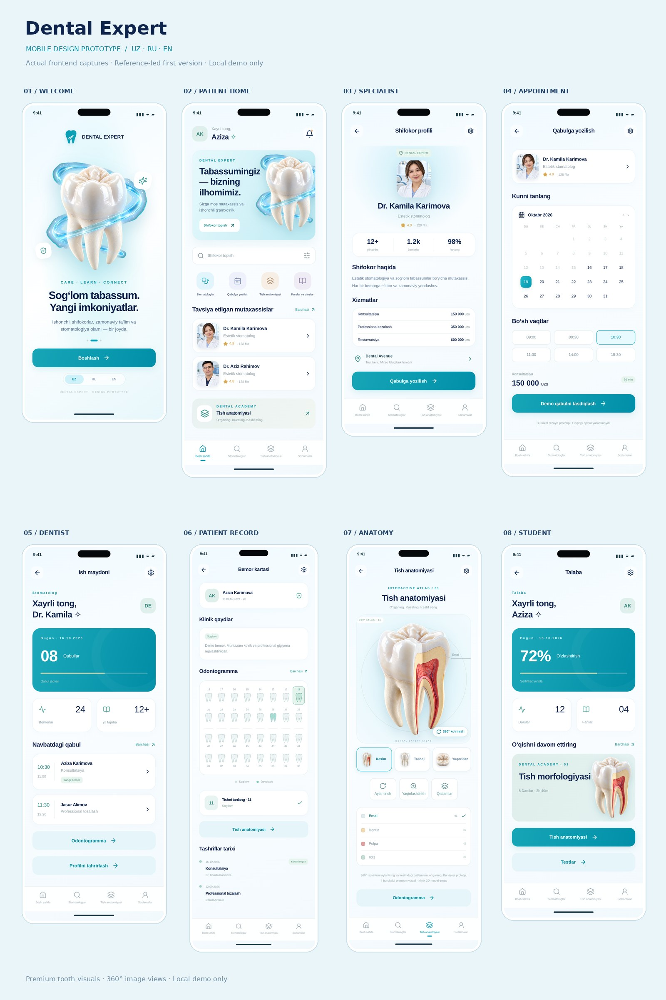

# Dental Expert — mobil dizayn prototipi

Quyidagi rasmlar **ishlaydigan frontenddan olingan screenshotlar**. `Tish Rasm.rar`dagi tishlar asosida premium renderlar tayyorlanib splash, bosh sahifa va anatomiyadagi uch ko‘rinishga joylangan; anatomiya tugmasi bir xil premium uslubdagi to‘rt burchakli 360° vizual ko‘rinishni ochadi (bu haqiqiy 3D mesh emas). Bu loyiha React + TypeScript + Vite asosidagi UI/UX demo; haqiqiy qabul, bemor ma’lumotlari yoki to‘lov tizimi ulanmagan.

[8 ekranli previewni katta ochish](prototype/screenshots/jpg/preview-board.jpg) · [Onboarding](prototype/screenshots/jpg/onboard.jpg) · [Bemor bosh sahifasi](prototype/screenshots/jpg/home.jpg) · [Stomatolog profili](prototype/screenshots/jpg/profile.jpg) · [Qabulga yozilish](prototype/screenshots/jpg/booking.jpg) · [Anatomiya](prototype/screenshots/jpg/anatomy.jpg) · [360° old ko‘rinish](prototype/screenshots/jpg/anatomy-360.jpg) · [360° yon ko‘rinish](prototype/screenshots/jpg/anatomy-360-side.jpg)

Tahrirlanadigan [eski GLB drafti](prototype/assets/tooth3d/reference-molar.glb) arxivda saqlangan; u premium vizualning o‘rnida ko‘rsatilmaydi.

## Interaktiv prototipni ko‘rish

[Interaktiv prototipni brauzerda oching](https://davlatsudekspert.github.io/DentalExpert/?screen=anatomy&lang=uz). Tugmalar, tillar va ekranlar telefonda ishlaydi. GitHub Pages `prototype/demo.html` faylini joylaydi; bu demo hech qanday haqiqiy xizmatga ulanmaydi.

Offline ishlatish uchun [repository ZIPini yuklab oling](https://github.com/davlatsudekspert/DentalExpert/archive/refs/heads/main.zip), arxivni oching va `prototype/demo.html` faylini kompyuter brauzerida oching.

## Claude Code bilan davom ettirish

Claude Code’ga ushbu repositoryning `main` branchini ochib, [`prototype/CLAUDE_START_HERE.md`](prototype/CLAUDE_START_HERE.md) va [`prototype/DESIGN_HANDOFF.md`](prototype/DESIGN_HANDOFF.md)ni o‘qishni ayting. Barcha kod, 19 ekran screenshotlari va original Blender 3D tish sahnasi `prototype/` ichida.
